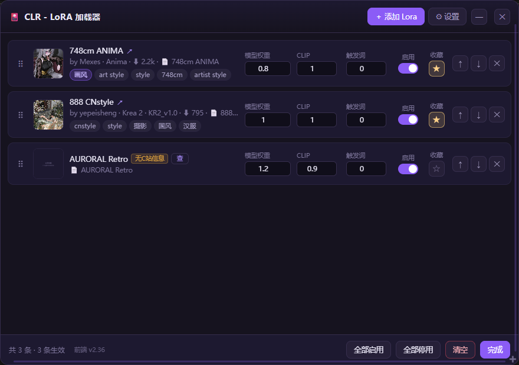
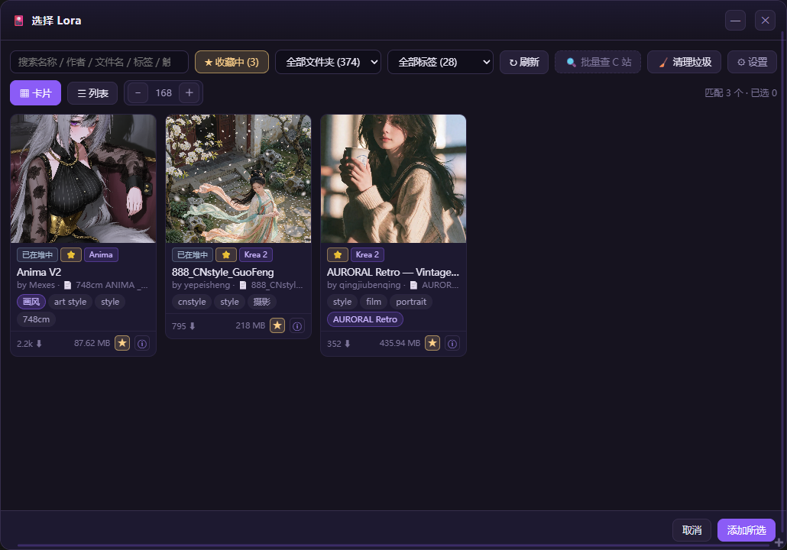

# Civitai LoRA Rack (CLR)

**ComfyUI 的 LoRA 管理器** —— 在一个节点上管理整排 LoRA，单独调权重，并把 Civitai 上的作者、示例图、触发词直接拉到画布旁边。

本项目由AI生成，代码都是AI写的。

[English](README.md) · [使用说明书](docs/USAGE.zh-CN.md)



---

## 它解决什么问题

ComfyUI 自带的 `Load LoRA` 一次只管一个文件。一个工作流用六七个 LoRA 时，你会把节点串成一长条，还得记住哪个权重对应哪个文件、触发词在哪个文件夹里翻。

要是你下载的LoRA有几十个几百个，要找对应LoRA的信息就会相当的麻烦。

CLR 把整排 LoRA 收进**一个**节点：

- 排序、启用/停用、单独调权重，不用重新连线
- 每个文件旁边直接显示 C 站信息（作者、基座模型、下载量、示例图）
- 按名称、作者、标签、触发词搜 LoRA，而不是翻目录
- 可以给LoRA加上自定义标签，自定义LoRA的说明，根据自己写的标签和说明就能明白这个LoRA对自己来说有什么用

## 功能

|             |                                                      |
| ----------- | ---------------------------------------------------- |
| **堆节点**     | 一个节点放多条 LoRA；每条独立 `模型` / `CLIP` / 触发词权重；拖动排序；单条停用；收藏 |
| **选择器**     | 按名称、作者、文件名、标签、触发词搜索；按文件夹与标签筛选；卡片 / 列表两种视图            |
| **详情页**     | 作者、类型、基座模型、版本、下载量、收藏数、文件大小、SHA256、C 站示例图、训练触发词、训练参数  |
| **批量查 C 站** | 一键补齐列表里所有缺 C 站信息的 LoRA 的作者 / 标签 / 触发词                |
| **垃圾清理**    | 找出孤立预览图 / 信息侧车 / 下载残留 / 0 字节空文件，移入隔离区（可还原）           |
| **自定义笔记**   | 给每条 LoRA 加标签、说明、封面图；存本地，刷新 C 站不会覆盖                   |
| **中英双语**    | 设置里切换，浏览器记住选择                                        |



## 节点

| 节点 type         | 显示名                  | 作用                                   |
| --------------- | -------------------- | ------------------------------------ |
| `CFTLoraStack`  | **CLR - LoRA 加载器**   | 一次应用多条 LoRA，输出 `模型` / `CLIP` / `触发词` |
| `CFTLoraLoader` | **CLS - 单条 LoRA 加载** | 单条 LoRA 的简单加载器                       |

> 节点 type 保留了历史前缀 `CFT`，是为了让已有工作流不用改；旧工作流打开不会红框。

`lora_stack` 输入接受一个 JSON 数组（与主流的 LoRA Stack 节点同一套协议），工作流可以互相搬运：

```json
[
  {
    "lora": "Anima/xxx.safetensors",
    "weight": 1.0,
    "text_encoder_weight": 1.0,
    "trigger_weight": 0.0,
    "hidden": false
  }
]
```

`path` / `file` 可作为 `lora` 的别名，`clip_weight` 可作为 `text_encoder_weight` 的别名。

## 安装

**ComfyUI-Manager** —— 搜索 `Civitai LoRA Rack` 安装，然后重启。

**手动**

```bash
cd ComfyUI/custom_nodes
git clone https://github.com/Hakaki/ComfyUI-Civitai-LoRA-Rack
```

重启 ComfyUI。唯一依赖是 `requests`，ComfyUI 自带。

## 配置

点节点上的 ⚙（或选择器里的齿轮），把 **Civitai API Key** 填进去。

- Key 存在本机 `ComfyUI/user/default/Civitai-LoRA-Rack/config.json`
- 不会上传、不会写进日志；HTTP 接口只返回脱敏值（`********abcd`）
- Key 在 <https://civitai.com/user/account> → API Keys 申请

同一个文件里还可以填：

```json
{
  "api_key": "",
  "site_domain": "civitai.com",
  "proxy_enabled": false,
  "proxy_address": "http://127.0.0.1:7890",
  "extra_loras_dirs": []
}
```

- `site_domain` —— 连不上 `civitai.com` 时指向镜像站
- `proxy_enabled` / `proxy_address` —— 只让本插件的请求走代理
- `extra_loras_dirs` —— LoRA 不在 `ComfyUI/models/loras` 时，补充扫描目录

**不填 Key 也能用。** 没有 Key 时，所有能离线读到的东西照常显示，只是「从 C 站刷新」对没有本地元数据的文件不可用。

## 元数据从哪来

按下面的顺序读，所以**完全离线也有完整信息**：

1. `<文件名>.civitai.info` —— 文件旁边的 C 站完整模型版本 JSON
2. `<文件名>.info.json` —— 精简版
3. **safetensors 文件头** —— 文件内 `ss_*` / `modelspec.*` 字段
4. **C站 API** —— 只有点「从 C 站刷新」时才走，按 SHA256 匹配，结果写回 `.civitai.info`

预览图按 `<名>.preview.png` → `<名>.preview.jpg` → `<名>.png` … 的顺序找。

## 常见问题

**会下载模型吗？** 不会。CLR 只管理你已经下载到磁盘上的 LoRA。

**会误删文件吗？** 不会自动删。清理工具只*列出*候选，你确认后才移动，而且一律移到 `ComfyUI/models/loras/.cft_trash/` 并留清单，可以还原。

**我的标签和说明存在哪？** 存在 LoRA 文件旁边的侧车里，所以整个目录搬走也不会丢。

**支持 ComfyUI 1.5x 的 Vue 节点吗？** 支持。`lora_stack` 字段在经典画布和 Vue 渲染下都会隐藏。

## 开发

```bash
# 后端（不需要启动 ComfyUI）
python tests/test_metadata.py
python tests/test_plugin.py
python tests/test_cleanup.py

# 前端 DOM 沙盒（需要本机 Chrome）
node tests/run_sandbox.mjs
```

## 许可证

MIT，见 [LICENSE](LICENSE)。
