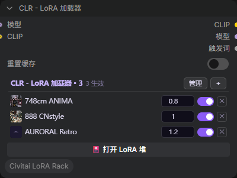
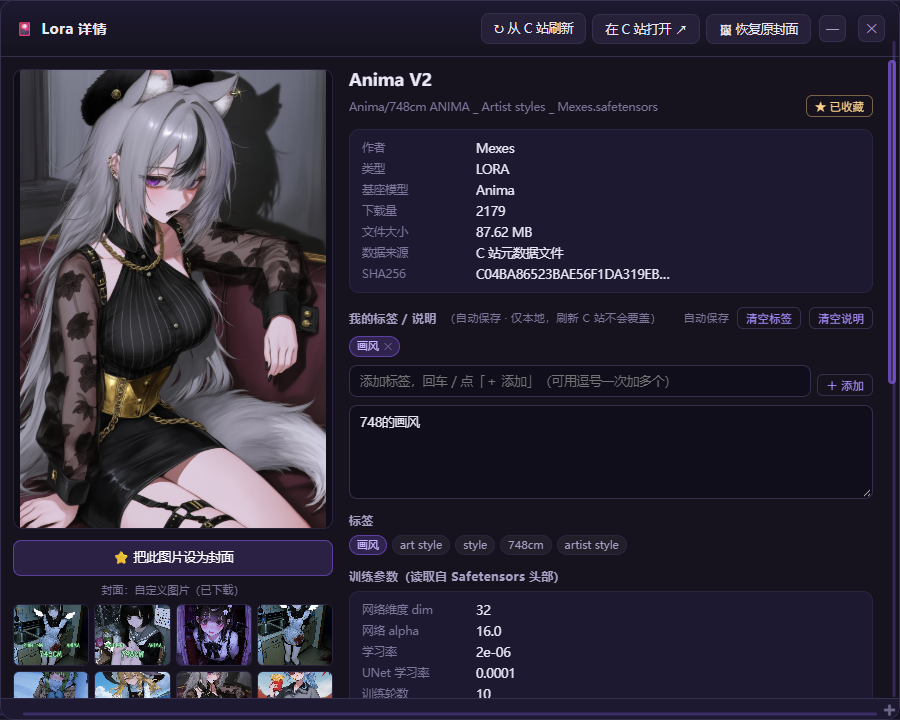
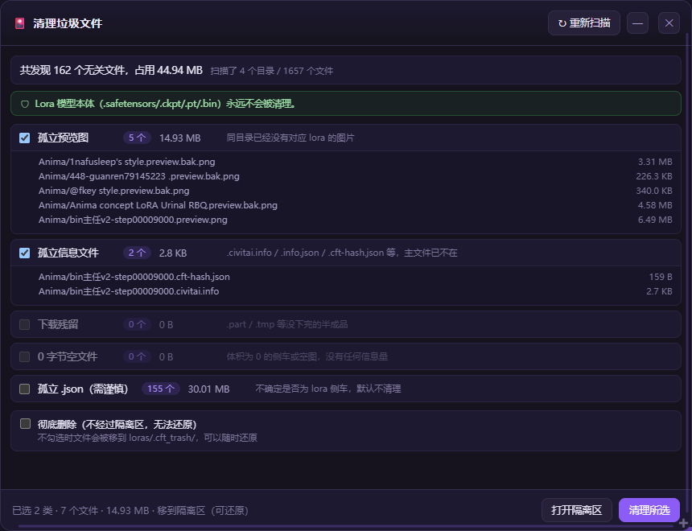
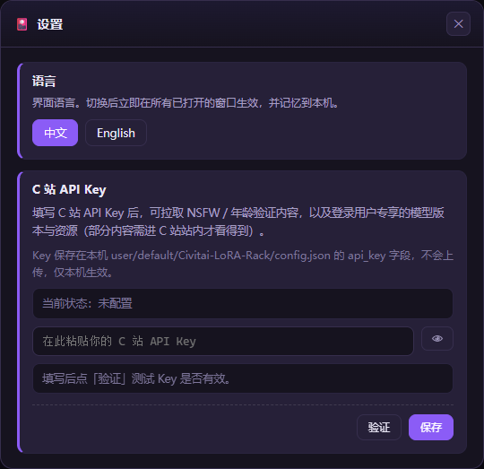
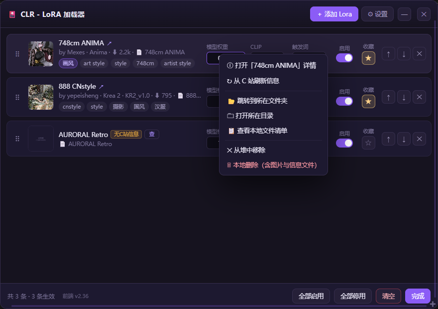

# CLR 使用说明书

面向已经装好插件的用户，讲**怎么用**。装不上、装在哪，看 [README.zh-CN.md](../README.zh-CN.md)。

[English](USAGE.md)

---

## 一、三分钟上手

1. **加节点** —— 画布上双击搜索 `CLR`，选 **CLR - LoRA 加载器**。
2. **加 LoRA** —— 点节点面板右上角的 **＋**，在选择器里点卡片选中若干条，点 **添加所选**。
3. **调权重** —— 节点面板里每条有自己的权重框和一个启用开关，改完立刻生效。

想看得更清楚、想调 CLIP / 触发词权重，点面板上的 **管理**（或节点底部的 **🎴 打开 LoRA 堆**）打开LoRA堆窗口。

> **API Key 是可选的。** 不填也能完整使用离线信息。只有想拉 NSFW 内容、或让没有本地元数据的文件去 C 站查一次，才需要它。填法见第八节。

---

## 二、两个界面，一个堆

同一份数据在两种界面里显示，改哪个都写回同一个节点。

|         | 节点内嵌面板        | 堆窗口                       |
| ------- | ------------- | ------------------------- |
| 打开方式    | 节点本身就是        | **管理** / **🎴 打开 LoRA 堆** |
| 适合      | 出图时快速开关、微调权重  | 整理、排序、看信息、批量操作            |
| 权重      | 只有模型权重        | 模型 / CLIP / 触发词 三个        |
| 缩略图     | 有（小）          | 有（大）                      |
| 标签 / 作者 | 悬停名字看 tooltip | 直接列出                      |

堆窗口是**按节点独立**的：两个 CLR 节点可以同时各开一个堆窗口，互不覆盖。

---

## 三、节点内嵌面板



| 位置     | 功能                          |
| ------ | --------------------------- |
| **管理** | 打开堆窗口（完整版）                  |
| **＋**  | 打开选择器添加 LoRA                |
| 缩略图    | 点开这条的详情窗                    |
| 名字     | 同上；悬停可看完整路径、作者、基座模型         |
| 权重框    | 直接改模型权重，支持任意实数              |
| 开关     | 单条启用 / 停用，停用的条目变灰但**留在列表里** |
| **✕**  | 从堆里移除（**不动磁盘文件**）           |

**几个细节：**

- 节点拖多高，列表就显示多高，超出部分滚动。列表上的滚轮事件被拦住了，不会变成缩放画布。
- 条目超过 200 条时只渲染前 200 条，末尾提示「只渲染前 200 条，点「管理」查看全部」。数据不会丢，只是不一次画完。
- 空堆显示「空 · 点「＋」添加 Lora」。
- 在面板里右键某一行，可直接定位文件夹或本地删除，见第九节。

---

## 四、LoRA 堆窗口


### 顶部

- **＋ 添加 Lora** —— 打开选择器
- **⚙ 设置** —— API Key 与语言

### 每一行

```
⠿ [图] 名字 ↗  副本 1/2 ▶视频 无C站信息 [查]
        by 作者 · 基座模型 · 版本 · ⬇ 12.3k · 📄 文件名
        [我的标签] [C站标签] [触发词…]
        模型权重 [1.00]  CLIP [1.00]  触发词 [0.00]  启用[开关]  收藏[☆]
                                                      ↑ ↓ ✕
```

| 元素                | 说明                                 |
| ----------------- | ---------------------------------- |
| **⠿** 拖动把手        | 按住它上下拖，调整顺序。只有把手能拖，避免误触输入框         |
| **↗**             | 在浏览器里打开这条的 C 站页面                   |
| **副本 i/n**        | 磁盘上有同名的多个文件，靠副标题里的 `📄 文件名` 区分     |
| **▶ 视频**          | 这条的封面是视频                           |
| **无C站信息** + **查** | 缺作者 / 标签 / 触发词。点 **查** 单独去 C 站查这一条 |
| **查询失败**          | 上一次查询出错，鼠标悬停看名字或再点一次 **查**         |
| **模型权重**          | 主权重，最常调的就是它                        |
| **CLIP**          | 文本编码器权重，单独控制「对提示词的影响强度」            |
| **触发词**           | 触发词自动拼进提示词的强度。为 0 表示不加             |
| **启用**            | 同面板里的开关                            |
| **收藏**            | ☆ / ★，在选择的「⭐ 收藏」里能一键筛出来            |
| **↑ ↓**           | 上移 / 下移一位                          |
| **✕**             | 从堆移除，不动文件                          |

**权重可以填任意实数** —— 负数、`3.5`、`0.625` 都接受，没有上下限。输入框步进是 `0.05`（点上下箭头时），手动输入不受限。

**触发词权重什么时候有用：** 有些 LoRA 的触发词会污染整段提示词。把模型权重留在 `1.0` 保证画风，把触发词权重调到 `0` 或 `0.5`，可以减弱它对其他内容的干扰。

### 底部

- 左边统计：`共 N 条 · M 条生效`，以及**前端版本号** `前端 v2.36`。出问题时先看这个号对不对；扩展 JS 会被浏览器缓存，号不对就 `Ctrl+Shift+R` 强刷。
- **全部启用** / **全部停用** —— 停用只是标记 `hidden`，条目全部保留，比重建堆便宜。
- **清空** —— 二次确认后清空当前节点的列表，**不动磁盘**。
- **完成** —— 关窗。

---

## 五、选择器（点 ＋ 打开）


> 关于这张截图：它是点了「⭐ 收藏」筛选后的样子 —— 作者的模型库以 NSFW 内容为主，不方便公开全量列表。工具栏、卡片布局、底部按钮与完整视图完全一致，本机目录路径也做了隐去处理。

### 顶部筛选

| 控件                  | 说明                                      |
| ------------------- | --------------------------------------- |
| 搜索框                 | 同时匹配：名称、作者、文件名、C 站标签、触发词、**你自己加的标签**    |
| **⭐ 收藏 (n)**        | 只看收藏的，再点一次取消。可与其他筛选叠加                   |
| 文件夹下拉               | `全部文件夹 (N)` + 每个子目录的条数                  |
| 标签下拉                | 分「我的标签」「C 站标签」两组，括号里是条数；同名标签会合并到「我的标签」组 |
| **↻ 刷新**            | 重新扫描模型目录（磁盘上新加 / 删了文件后用）                |
| **🔍 批量查 C 站**      | 见本节末尾「批量查 C 站」                          |
| **🧹 清理垃圾**         | 见第七节                                    |
| **⚙ 设置**            | API Key / 语言                            |
| **▦ 卡片** / **☰ 列表** | 两种视图，选择会记住                              |
| **− N ＋**           | 卡片尺寸，选择会记住                              |

### 点卡片哪里 = 做什么

这是最容易误操作的地方，记两条就够：

- **缩略图** 或 **ⓘ** → 打开**详情窗**
- **其他地方**（标题、标签、副标题、空白）→ **选中 / 取消选中**

卡片右下角的 **☆** 是收藏，点一下变 ★，不会触发选中。

已经在这个堆里的 LoRA 会带「已在堆中」徽标，点它只会提示「该 Lora 已在堆里」，防止重复添加。

底部左边显示扫描到的模型目录，右边 **取消** / **添加所选**。

### 批量查 C 站

- **查询范围 = 当前筛选出来的列表**，不是整个模型库。想只查某个文件夹，先筛好再点。
- 只查「缺作者 / 标签 / 触发词」的条目，已经有完整信息的不重复请求。
- 一次最多处理 **200 条**，超了会提示「本次仅处理前 200 条，可缩小筛选范围再查」。
- 查询中按钮上显示进度 `正在查询 C 站 3/48…`，每条可能要几秒。
- 结果按 SHA256 匹配写回文件旁的 `.civitai.info`，下次离线也能看到。
- 结束时汇总：`命中 12 · 未收录 3 · 失败 0`。「未收录」表示 C 站上没有这个文件（可能是自己炼的或私有模型），不是出错。

---

## 六、详情窗



三个入口都能打开：选择器里点缩略图 / ⓘ、堆窗口里点名字、节点面板里点缩略图。同一个 LoRA 只会开一个详情窗，重复打开会聚焦到已有那个。

### 左栏：图

- 主图 / 视频会显示在最大那块。
- **点它放大**：进入灯箱，`←` `→` 翻页，`Esc` 或 `✕` 或点图片外区域关闭。
- **⭐ 设为封面**：默认是灰的。先在下方示例图里点一张，按钮变成「⭐ 把此图片设为封面」，再点才生效。
  - 图片封面会**下载到本地**当预览图。
  - 视频封面只记录链接，不下载。
- 图下方有一行说明封面当前来源：`封面：本地预览图` / `封面：C 站图片` / `封面：自定义图片（已下载）` / `封面：自定义视频（链接）` 等。
- 设过自定义封面后，标题栏会出现 **🖼 恢复原封面**。
- 下方缩略图是最多 8 张 C 站示例图，点一张就换到主图位置。

### 右栏：信息

按顺序列出：作者、类型、基座模型、版本、发布时间、下载量、收藏数、文件大小、数据来源（`C 站元数据文件` 或 `Safetensors 头部`），以及：

- **训练触发词** —— 点一下可复制
- **训练参数（读取自 Safetensors 头部）** —— 网络维度、alpha、学习率、优化器、训练分辨率、轮数、步数等
- **打标高频词（可作为触发词参考）** —— 训练时打得最多的词
- **C 站描述** —— 模型作者写的原文

### 我的标签 / 说明

这是你自己的区域，**存在本地，刷新 C 站不会覆盖**。

- **加标签**：输入后按回车，或点 **＋ 添加**。可以用逗号一次加多个（`风景, 夜景, 蓝调`）。
- **删标签**：点标签上的 `✕`。
- **清空标签 / 清空说明**：标题行右侧两个按钮，各自独立，互不影响。
- **写说明**：下面的大文本框，随便写「这个 LoRA 适合什么、我一般用多少权重」。
- **自动保存**：不用点保存按钮。标签即时存，说明停手约 0.7 秒后存，关窗时还会再提交一次。标题行右侧的状态字会从「自动保存」短暂变成 **已保存 ✓**。

标签和说明存在 LoRA 文件旁边的 `.cft-user.json` 里，所以整个模型目录搬走也不会丢。

---

## 七、清理垃圾与隔离区

入口：选择器工具栏的 **🧹 清理垃圾**。



### 扫什么

只扫与现有 LoRA 无关的游离文件，分五类：

| 分类            | 内容                                                       | 默认勾选   |
| ------------- | -------------------------------------------------------- | ------ |
| 孤立预览图         | 同目录已经没有对应 LoRA 的图片                                       | ✅      |
| 孤立信息文件        | `.civitai.info` / `.info.json` / `.cft-hash.json`，主文件已不在 | ✅      |
| 下载残留          | `.part` / `.tmp` / `.crdownload` 等半成品                    | ✅      |
| 0 字节空文件       | 体积为 0 的侧车或空图                                             | ✅      |
| 孤立 .json（需谨慎） | 分不清是不是 LoRA 侧车的通用 json                                   | ❌ 默认不勾 |

### 硬边界

> **LoRA 模型本体（`.safetensors` / `.ckpt` / `.pt` / `.bin`）永远不会出现在候选列表里，也永远不会被清理。** 这句话在窗口顶部就有，不是口头承诺 —— 后端候选生成阶段就排除了本体。

### 两种处理方式

- **移到隔离区（推荐）** —— 文件挪到 `ComfyUI/models/loras/.cft_trash/<时间戳>/`，同时写一份 `_cft_trash_manifest.json` 记录原位置，随时能还原。
- **彻底删除** —— 需要显式勾选，再加二次确认，删了就没有了。

### 隔离区

清理完点 **打开隔离区**：

- 按批次列出（每次清理一个批次），显示文件数和占用体积
- **还原批次** —— 全部文件回到原来的位置
- **彻底删除**（单批次）—— 不可还原
- **🗑 清空隔离区** —— 清掉全部批次，不可还原

`.cft_trash` 目录本身即使空了也会保留，不会被后续清理流程误伤。

### 单条本地删除

不需要进清理窗口。在堆窗口、选择器或节点面板里右键某条 LoRA → **本地删除（含图片与信息文件）**。

流程刻意做成三步，防止手滑：

1. 先列出会被处理的**全部文件清单**（本体 + 预览图 + 侧车）和合计体积
2. 选 **移到隔离区（推荐）** 还是 **彻底删除（不可还原）**
3. 最后确认

删除成功后，如果这条在那个堆里，会自动从堆上移除。

---

## 八、设置

入口：节点 / 堆窗口 / 选择器三处的 **⚙ 设置**。



### 语言

**中文** / **English**，点一下立刻在所有已打开的窗口生效，并记在本机浏览器里。

### C 站 API Key

- 状态行会写 `当前状态：未配置` 或 `当前状态：已配置（********abcd）`。
- 输入框是密码型，点右边的 **👁** 可临时明文看一眼。
- **验证** —— 只测合法性，不保存。通过会显示 `✓ 有效 · 账号 xxx`。
- **保存** —— 先存盘，然后自动验证一次。
- **已存过 Key 时**：输入框留空点保存**不会**清掉原来的 Key，只提示「未填写 API Key，已保存的 Key 未改动」。真要删，用 **清除 API Key**。
- 清除后 NSFW / 登录限定内容就看不了了，需要重新填。

Key 保存在本机 `ComfyUI/user/default/Civitai-LoRA-Rack/config.json` 的 `api_key` 字段。它不会上传、不会写日志，HTTP 接口只回脱敏值。

Key 在 <https://civitai.com/user/account> → API Keys 申请。

### 同一个配置文件里的其他字段

设置面板没做 UI 的项，可以直接编辑这个 json：

```json
{
  "api_key": "",
  "site_domain": "civitai.com",
  "proxy_enabled": false,
  "proxy_address": "http://127.0.0.1:7890",
  "extra_loras_dirs": []
}
```

| 字段                                | 用途                                                 |
| --------------------------------- | -------------------------------------------------- |
| `site_domain`                     | 连不上 `civitai.com` 时指向镜像站                           |
| `proxy_enabled` + `proxy_address` | 只让本插件的请求走代理，不影响 ComfyUI 其他请求                       |
| `extra_loras_dirs`                | LoRA 不在 `ComfyUI/models/loras` 下时，补充扫描目录（数组，写绝对路径） |

改完重启 ComfyUI 生效。

---

## 九、右键菜单速查

三个地方都能右键：**堆窗口的行**、**选择器的卡片**、**节点面板的行**。菜单项略有差异：

| 菜单项            | 堆窗口 | 选择器 | 节点面板 |
| -------------- | :-: | :-: | :--: |
| 查看详情           |  ✅  |  ✅  |   ✅  |
| 从 C 站刷新信息      |  ✅  |  —  |   —  |
| 收藏 / 取消收藏      |  —  |  ✅  |   —  |
| 跳转到所在文件夹（选中文件） |  ✅  |  ✅  |   ✅  |
| 打开所在目录（不选中文件）  |  ✅  |  ✅  |   —  |
| 查看本地文件清单       |  ✅  |  ✅  |   ✅  |
| 从LoRA堆中移除      |  ✅  |  —  |   —  |
| 本地删除（含图片与信息文件） |  ✅  |  ✅  |   ✅  |

「跳转到所在文件夹」和「打开所在目录」的区别：前者在文件管理器里**选中**那个文件，后者只打开目录。前者更慢（Windows 上要拉起 explorer），后者快。



---

## 十、常见问题

**节点里看不到缩略图 / 一片空白？**  
先确认磁盘上真有文件（点 ＋ 能列出来就说明扫描正常）。如果只是图不显示，多半是路径里有特殊字符，或者 ComfyUI 重启后前端缓存了旧的 JS —— 看堆窗口底部的 `前端 vX.XX` 是否等于插件版本，不等就 `Ctrl+Shift+R`。

**`lora_stack` 那个输入框呢？**  
被隐藏了，但**数据仍然在它里面**，序列化照旧。这是故意的：藏掉 widget 本身会让 `widgets_values` 丢值，你的堆配置就白配了。所以别去找它，也别手动往 widgets 里塞值。

**换台机器打开工作流，LoRA是空的？**  
工作流里存的是**相对路径 + 文件名**。目标机器上文件不在同名位置，就匹配不上。另外插件有一份按节点 id 存在本机浏览器的备份，用来救「当时没保存工作流」的情况 —— 首次加载时如果发现工作流里是空堆但本机有备份，会弹一条 `⚠ 已从本机备份恢复 N 条`。

**同名副本是什么？**  
同一份 LoRA 你下载了两次（文件名不同）。插件用模型名的 hash 把它们归为一组，标 `副本 1/2`，靠副标题里的 `📄 文件名` 分辨。它不会替你删任何一个。

**权重填 0 和关掉开关有区别吗？**  
有。权重 0 仍然会执行一次加载（占显存、占时间）；关掉开关是整个跳过。想彻底不生效就用开关。

**「未收录」是报错吗？**  
不是。意思是 C 站上没有这个文件（自炼模型、私有模型、或已被作者删除）。属于正常结果。

---

## 附：快捷键

| 按键      | 作用                 |
| ------- | ------------------ |
| `Esc`   | 关灯箱 / 关最上层弹窗       |
| `←` `→` | 图箱里翻上一张 / 下一张      |
| `Enter` | 在「我的标签」输入框里，把标签加进去 |
